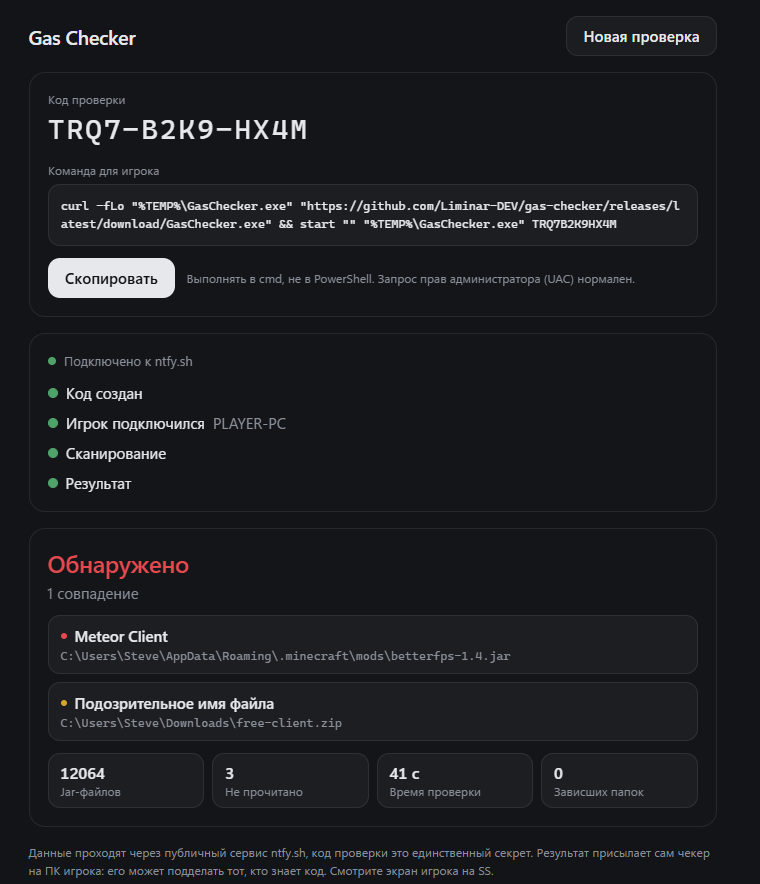
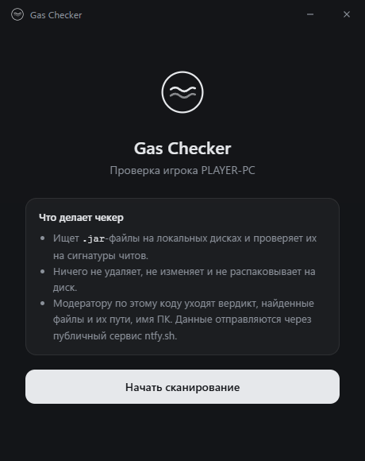
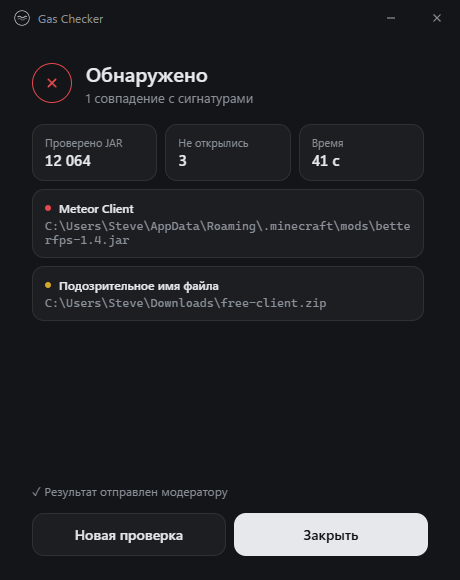
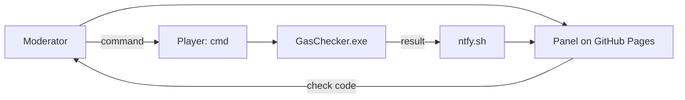

<div align="center">


<p>Free SS checker for Minecraft. No server, no accounts.</p>

<p>
<b>English</b> ·
<a href="README.md">Русский</a> ·
<a href="https://liminar-dev.github.io/gas-checker/">Panel</a> ·
<a href="https://github.com/Liminar-DEV/gas-checker/releases">Releases</a>
</p>

<p>
<a href="https://github.com/Liminar-DEV/gas-checker/releases"></a>
<a href="https://github.com/Liminar-DEV/gas-checker/actions/workflows/release.yml"></a>
<a href="LICENSE"></a>


</p>



<table>
<tr>
<td></td>
<td></td>
</tr>
</table>

<sub>The screenshots use made-up data. The checker UI is in Russian.</sub>

</div>

## What it is

Gas Checker helps run screenshare (SS) checks on Minecraft players. The moderator opens a web panel on GitHub Pages and gets a code and a one-line command for the player. The player runs a small exe, it scans the PC and sends the result to the panel. There is no server and no payment: just a static page and the public [ntfy.sh](https://ntfy.sh) service.

The source code is open for viewing and use, but the license has restrictions (see [License](#license)).

## How it works



The panel and the checker are not connected directly. The ntfy.sh topic is derived from the check code, and both sides read and write it.

## Quick start

### Moderator

1. Open the [panel](https://liminar-dev.github.io/gas-checker/).
2. Click "Новая проверка" (new check): a code and a command appear.
3. Send the command to the player and watch the panel: connection, progress, verdict, list of findings.

You can host your own copy of the panel: Settings → Pages → Deploy from branch → `/docs` folder.

### Player

1. Paste the command you received into cmd (not PowerShell):

   ```bat
   curl -fLo "%TEMP%\GasChecker.exe" "https://github.com/Liminar-DEV/gas-checker/releases/latest/download/GasChecker.exe" && start "" "%TEMP%\GasChecker.exe" CODE
   ```

   `CODE` is the 12 characters from the moderator.
2. Accept the UAC prompt. Administrator rights are needed to read process memory.
3. Read the consent screen and click the start button. The result is sent to the moderator automatically.

## What it looks for

The checker searches three categories:

- **Files:** all fixed drives (network and removable drives are skipped), `.jar` contents and other files.
- **Memory:** processes worth checking.
- **Traces of runs:** Windows logs and caches, running processes.

Among open-source clients it finds Meteor, Wurst, LiquidBounce and Baritone, for example. How other cheats are detected is not described: the rules live in an encrypted file ([details](desktop/src-tauri/rules/README.md)).

When a scan starts, the checker downloads SS tools from their official sites (Everything, JournalTrace, Shellbag Analyzer) and opens them. It puts the Everything search string on the clipboard.

The tools go into a new, randomly named folder `C:\Windows\Temp\GasCheckerTools-…`. Ordinary users can neither list nor rename the parent folder, and the checker creates the new folder already restricted to Administrators and SYSTEM, so an ordinary process on the player's PC cannot swap files that the checker launches with administrator rights. The SHA-256 of Everything and JournalTrace is pinned in the code: if the hash does not match, the tool is not started. Shellbag Analyzer is not hash-checked because the vendor has no versioned links: it is protected only by HTTPS and the locked folder. The folders stay on disk after a check and can only be deleted as an administrator.

## Privacy and trust

- Data goes through ntfy.sh into a topic whose name is derived from the code. ntfy.sh keeps messages in its cache for about 12 hours.
- What is sent: verdict data, number of checked jars, findings with paths, PC name, scan progress. Paths may contain the Windows user name.
- The check code is the only secret. Anyone who knows it can read and write the topic. Do not publish it.
- `GasChecker.exe` is built by GitHub Actions from this code ([release.yml](.github/workflows/release.yml)).
- To verify the file: `certutil -hashfile "%TEMP%\GasChecker.exe" SHA256`. The hash must match `GasChecker.exe.sha256` from the release.
- SmartScreen and antivirus may complain: the exe is unsigned and reads process memory.
- The memory scan is read-only. The checker does not delete, modify or unpack anything to disk. The exe does not delete itself on exit either.

Message format and other details: [desktop/README.md](desktop/README.md) (in Russian).

## Limitations

- The result is reported by the client on the player's PC. Anyone who knows the code can forge a message. Use the check only while watching the player's screen.
- "Clean" is not a guarantee. The checker finds only what is in its rules; new versions and paid obfuscated clients may be missed.
- A build from source without the key has only the open rules and finds noticeably less. See [desktop/src-tauri/rules/README.md](desktop/src-tauri/rules/README.md).

## Build from source

You need Node.js, Rust stable-msvc, MSVC Build Tools and WebView2 (included in Windows 10/11).

```bash
cd desktop
npm ci
npm run build
```

Output: `desktop/src-tauri/target/release/gas-checker.exe`. Tests: `cd desktop/src-tauri && cargo test`.

## License

**Gas Checker License: MIT plus restrictions.** The source code is open for viewing and use (source-available), but this is not an OSI-approved open source license. Full text: [LICENSE](LICENSE).

Forbidden:

- deobfuscating, decompiling, reverse engineering, cracking or patching builds, and recovering the key or the encrypted rules;
- studying the detection behavior in order to create, fix or hide cheats so that they evade detection.

Any violation ends all your rights under the license immediately.

## Repository layout

```text
docs/                    moderator panel (GitHub Pages)
desktop/
  src/                   checker UI (HTML, CSS, JS)
  src-tauri/             Rust side: scanner, upload, rules
    rules/               encrypted rules and description
  scripts/               rules encryption
.github/workflows/       release build
assets/                  README images
LICENSE
```
