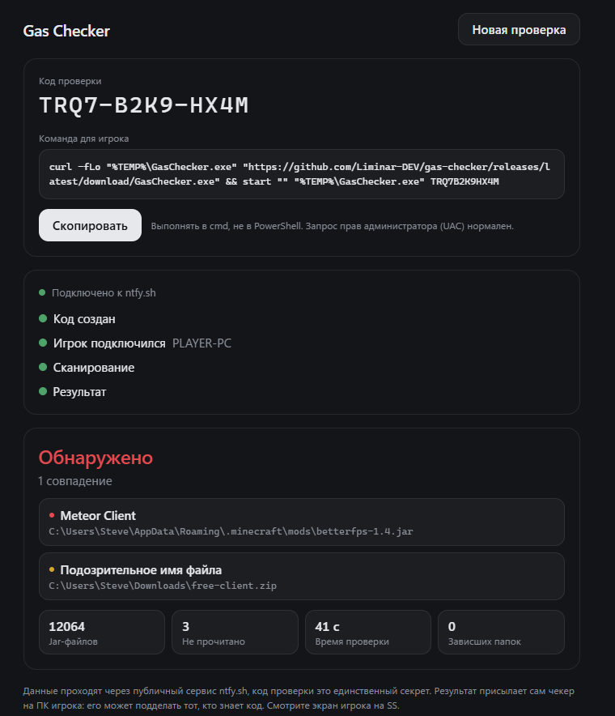
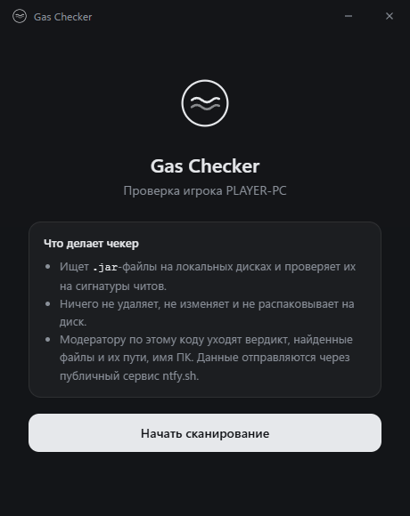
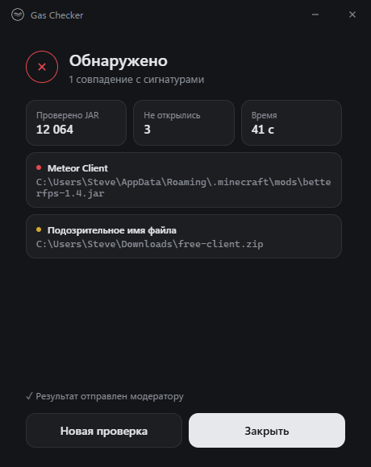
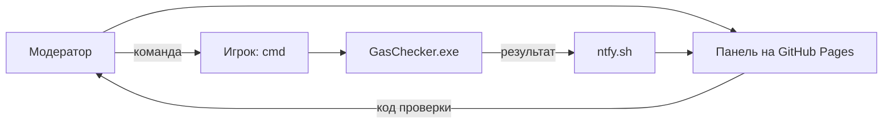

<div align="center">


<p>Бесплатный SS-чекер читов для Minecraft. Без сервера и аккаунтов.</p>

<p>
<a href="README.en.md">English</a> ·
<b>Русский</b> ·
<a href="https://liminar-dev.github.io/gas-checker/">Панель</a> ·
<a href="https://github.com/Liminar-DEV/gas-checker/releases">Релизы</a>
</p>

<p>
<a href="https://github.com/Liminar-DEV/gas-checker/releases"></a>
<a href="https://github.com/Liminar-DEV/gas-checker/actions/workflows/release.yml"></a>
<a href="LICENSE"></a>


</p>



<table>
<tr>
<td></td>
<td></td>
</tr>
</table>

<sub>На скриншотах выдуманные данные.</sub>

</div>

## Что это

Gas Checker помогает проводить проверки игроков Minecraft (SS). Модератор открывает веб-панель на GitHub Pages и получает код и команду для игрока. Игрок запускает небольшой exe, тот сканирует ПК и присылает результат в панель. Сервера и оплаты нет, только статическая страница и публичный сервис [ntfy.sh](https://ntfy.sh).

Исходный код открыт для просмотра и использования, но лицензия содержит запреты (см. [Лицензия](#лицензия)).

## Как это работает



Панель и чекер напрямую не связаны. Топик в ntfy.sh строится из кода проверки, оба конца читают и пишут в него.

## Быстрый старт

### Модератору

1. Откройте [панель](https://liminar-dev.github.io/gas-checker/).
2. Нажмите «Новая проверка»: появятся код и команда.
3. Отправьте команду игроку и смотрите панель: подключение, прогресс, вердикт, список находок.

Свою копию панели можно поднять самому: Settings → Pages → Deploy from branch → папка `/docs`.

### Игроку

1. Вставьте присланную команду в cmd (не в PowerShell):

   ```bat
   curl -fLo "%TEMP%\GasChecker.exe" "https://github.com/Liminar-DEV/gas-checker/releases/latest/download/GasChecker.exe" && start "" "%TEMP%\GasChecker.exe" КОД
   ```

   `КОД` это 12 символов от модератора.
2. Подтвердите запрос UAC. Права администратора нужны, чтобы читать память процессов.
3. Прочитайте экран согласия и нажмите «Начать сканирование». Результат уйдёт модератору сам.

## Что ищет

Чекер ищет по трём категориям:

- **Файлы:** все фиксированные диски (сетевые и съёмные пропускаются), содержимое `.jar` и другие файлы.
- **Память:** процессы, которые есть смысл проверить.
- **Следы запусков:** журналы и кеши Windows, запущенные процессы.

Из открытых клиентов находятся, например, Meteor, Wurst, LiquidBounce и Baritone. Как именно ищутся остальные читы, не описано: правила лежат в зашифрованном файле ([подробнее](desktop/src-tauri/rules/README.md)).

При старте скана чекер скачивает SS-утилиты с их официальных сайтов (Everything, JournalTrace, Shellbag Analyzer) в `%TEMP%\GasCheckerTools\` и открывает их. Поисковую строку для Everything кладёт в буфер обмена.

## Приватность и доверие

- Данные идут через ntfy.sh в топик, имя которого строится из кода. Сообщения лежат в кэше ntfy.sh около 12 часов.
- Отправляются вердикт-данные: число проверенных jar, находки с путями, имя ПК, ход скана. В путях может быть имя пользователя Windows.
- Код проверки единственный секрет. Кто знает код, может читать и писать в топик. Не публикуйте его.
- `GasChecker.exe` собирает GitHub Actions из этого кода ([release.yml](.github/workflows/release.yml)).
- Проверить файл: `certutil -hashfile "%TEMP%\GasChecker.exe" SHA256`. Хеш должен совпасть с `GasChecker.exe.sha256` из релиза.
- SmartScreen и антивирусы могут ругаться: exe не подписан и читает память процессов.
- Скан памяти только читает. Чекер ничего не удаляет, не изменяет и не распаковывает на диск. Сам exe при выходе тоже не удаляется.

Формат сообщений и остальные подробности: [desktop/README.md](desktop/README.md).

## Ограничения

- Результат присылает сам клиент на ПК игрока. Тот, кто знает код, может подделать сообщение. Используйте проверку только с демонстрацией экрана игрока.
- «Чисто» не гарантия. Чекер ловит только то, что есть в правилах, а новые версии и платные обфусцированные клиенты могут не находиться.
- Сборка из исходников без ключа содержит только открытые правила и ловит заметно меньше. См. [desktop/src-tauri/rules/README.md](desktop/src-tauri/rules/README.md).

## Сборка из исходников

Нужны Node.js, Rust stable-msvc, MSVC Build Tools и WebView2 (есть в Windows 10/11).

```bash
cd desktop
npm ci
npm run build
```

Результат: `desktop/src-tauri/target/release/gas-checker.exe`. Тесты: `cd desktop/src-tauri && cargo test`.

## Лицензия

**Gas Checker License: MIT плюс запреты.** Исходный код открыт для просмотра и использования, но это не OSI-open-source лицензия. Полный текст: [LICENSE](LICENSE).

Запрещено:

- деобфусцировать, декомпилировать, реверсить, взламывать и патчить сборки, а также добираться до ключа и зашифрованных правил;
- изучать поведение детекта, чтобы делать, чинить или скрывать читы так, чтобы они не находились.

Нарушение сразу прекращает все права по лицензии. При расхождении между русским пересказом и английским текстом в LICENSE верен английский.

## Структура репозитория

```text
docs/                    панель модератора (GitHub Pages)
desktop/
  src/                   интерфейс чекера (HTML, CSS, JS)
  src-tauri/             Rust-часть: сканер, отправка, правила
    rules/               зашифрованные правила и описание
  scripts/               шифрование правил
.github/workflows/       сборка релиза
assets/                  картинки для README
LICENSE
```
